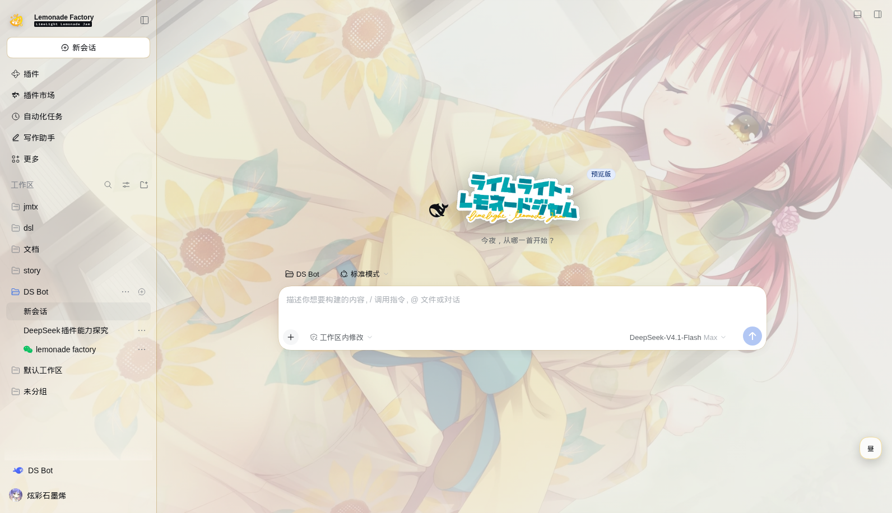
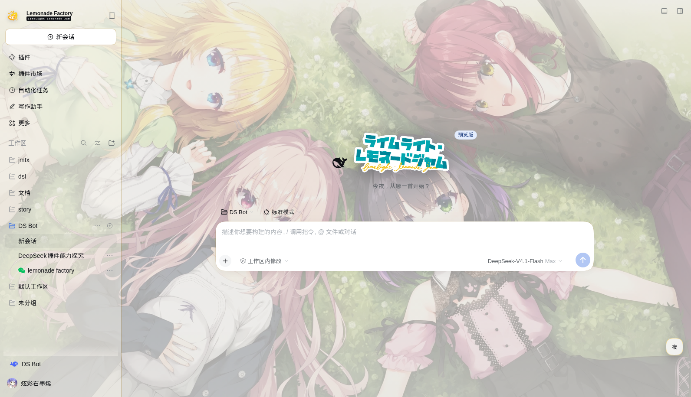
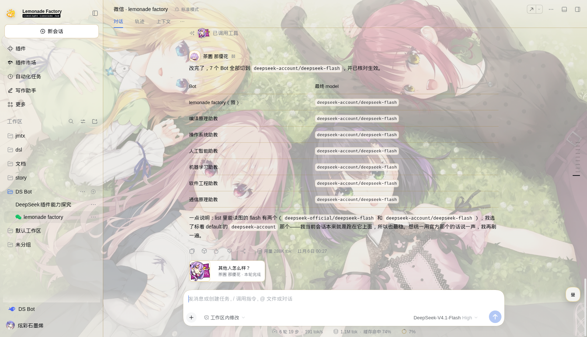
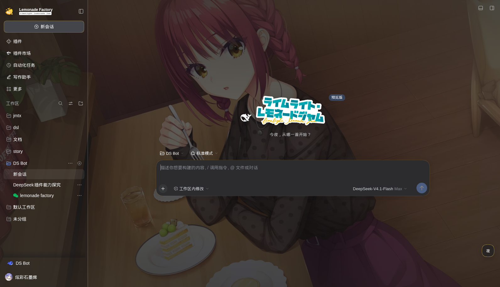
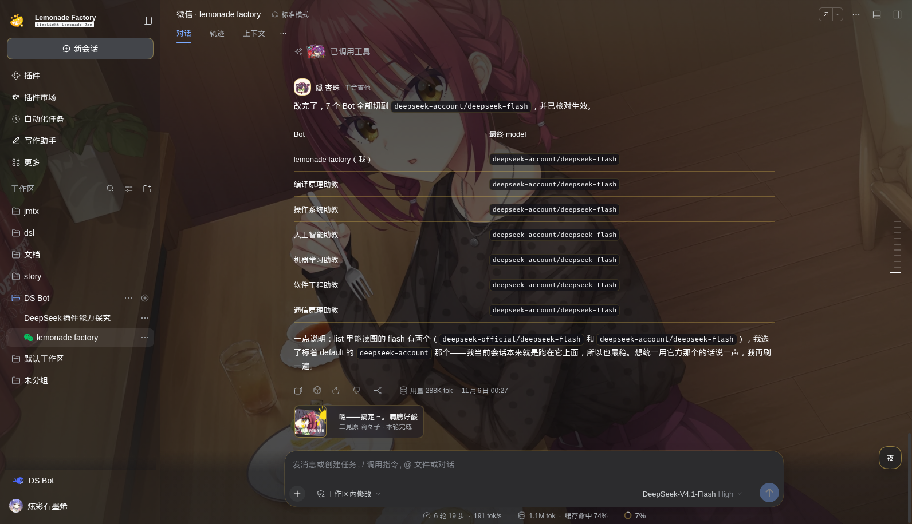
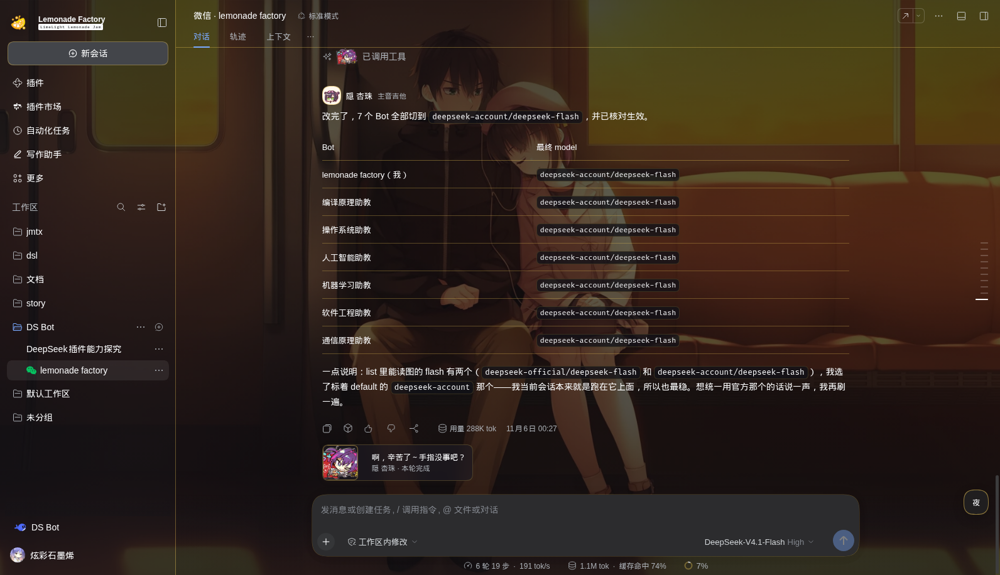
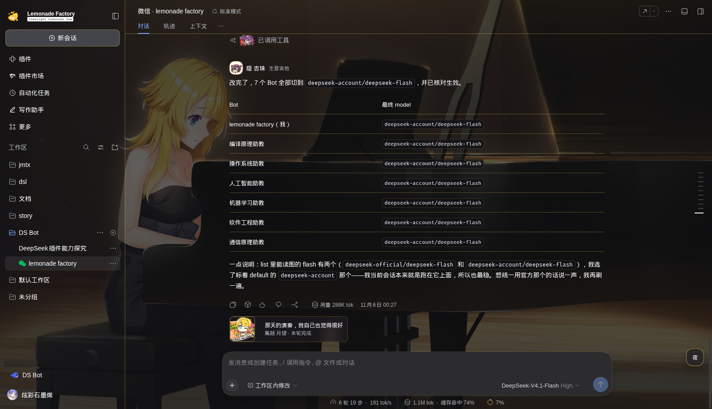

# LimeLight Lemonade Jam · DSH Skin

给 **DeepSeek Harness**（Web / Desktop）做的《ライムライト・レモネードジャム》主题皮肤。

昼夜双主题、六位角色按会话分配、消息与完成卡全部重绘。



## 特性

- **昼夜双主题**：昼＝纸白 / 天光 / 柠檬黄；夜＝深蓝 / 紫 / 酒红 / 暖黄。跟随系统，右下角按钮可手动切，选择会记住。
- **按会话分配角色**：每个对话首次打开时抽一位角色并固定，之后切走再切回来不变。权重：莉々子 5、恵凪 4、月望 2、杏珠 2、美玖 1、那優花 1。
- **对话页重绘**：官方 SD 头像 + 姓名 + 乐队职位；工具行贴纸；任务完成卡（台词取自游戏原文）。
- **品牌位**：侧栏柠檬徽标 + `Lemonade Factory`；空状态用游戏原版标题字，副标题「今夜，从哪一首开始？」。
- **背景**：1920×1080 剧情 CG，`cover` 平铺 + 分级磨砂，正文可读性优先。

## 安装

GitHub（推荐）：

```bash
dsh plugin --profile web add "github:Ririko2/lllj-dsh-skin"
```

Gitee 镜像：

```bash
dsh plugin --profile web add "git+https://gitee.com/kurumi0721114514/lllj-dsh_-skin.git"
```

安装后重启 `dsh web`（桌面端重启客户端），用新地址打开。


## 卸载

```bash
dsh plugin --profile web remove dsh-skin-lllj
```

## 截图

**昼**






**夜**









## 角色

| 角色 | 乐队位置 | 关键词 | 权重 |
|---|---|---|---|
| 陽見 恵凪 | 吉他 / 主唱 | 认真、努力方向总是错位、口癖「ふぁっく」 | 4 |
| 隠 杏珠 | 主音吉他 | 技术最好、最不敢相信自己 | 2 |
| 嶌越 月望 | 键盘 | 大小姐、稳重、结论先行 | 2 |
| 二見原 莉々子 | SNS / 后勤 | 直球、话最多、官方 CP 头子 | 5 |
| 礫川 美玖 | 贝斯 | 台词最少、一戳就炸 | 1 |
| 茶園 那優花 | 鼓 | 表姐、职业乐手、管男主叫「小雪」 | 1 |

## 分割线

四套，同一套内等宽格子、底边对齐、透明底。界面里按会话随机选一套，之后固定。

| # | 文件 | 内容 | 尺寸 |
|---|---|---|---|
| ① | `docs/div-faces.png` | 六人 SD 头像 + 金色圆环 | 760×140 |
| ② | `docs/div-cards.png` | LIVE FOR YOU 相纸卡 ×6 | 1180×158 |
| ③ | `docs/div-frame.png` | 彩色框 chibi ×6 | 1060×152 |
| ④ | `docs/div-stk.png` | 白色描边贴纸 ×6 | 1060×152 |


## 目录结构

```
dsh-skin-lllj/
├── package.json          # dsh.client.platform = web
├── cordis.patch.yml      # 插件注册
├── lib/
│   ├── index.js          # 服务端入口（空）
│   └── client.js         # 客户端：注入样式、DOM 装饰、背景层（图片 base64 内联）
└── docs/                 # README 用截图与分割线
```

## 素材与版权

角色、CG、SD、UI 素材版权归 **ゆずソフト / YUZUSOFT** 所有；本仓库只包含转换后的图片与样式代码，不含游戏本体。

仅供个人使用，请勿用于商业用途或二次分发素材。
