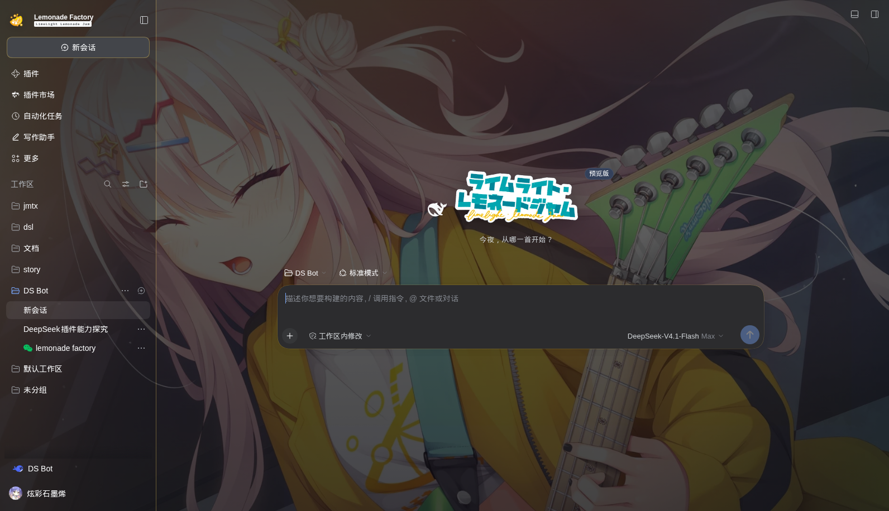
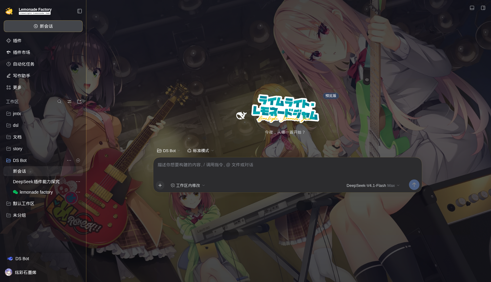

# LimeLight Lemonade Jam · DSH Skin

《ライムライト・レモネードジャム》主题皮肤，用于 **DeepSeek Harness Web / Desktop**。

昼 / 夜双主题，六位角色按会话随机分配并固定；消息头像、工具贴纸、完成卡、侧栏品牌位、空状态标题全部重绘。






## 特性

- **双主题**：昼（纸白 / 天光 / 柠檬黄），夜（深蓝 / 紫 / 酒红 / 暖黄），跟随系统或手动切换
- **按会话分配角色**：每个对话创建时抽一位角色（恵凪 / 杏珠 / 月望 / 莉々子 / 美玖 / 那優花），之后固定不变；权重按人设调整（莉々子、恵凪更高）
- **界面重绘**：消息头（官方 SD 头像 + 姓名 + 职位）、工具行贴纸、任务完成卡（台词取自游戏原文）
- **品牌位**：侧栏柠檬徽标 + `Lemonade Factory`；空状态使用游戏原版标题字
- **背景**：1920×1080 剧情 CG，`cover` 平铺 + 亮度/磨砂分级，正文可读性优先

## 安装

```bash
dsh plugin --profile web add git+https://gitee.com/kurumi0721114514/lllj-dsh_-skin.git
```

或从 tarball 安装：

```bash
dsh plugin --profile web add ./dsh-skin-lllj-0.5.5.tgz
```

安装后重启 `dsh web`（桌面端重启客户端），使用新的访问地址进入。

## 卸载

```bash
dsh plugin --profile web remove dsh-skin-lllj
```

## 结构

```
lib/client.js       客户端：背景层、主题 token、装饰注入（12 张图 base64 内联）
lib/index.js        宿主端入口
cordis.patch.yml    bundle patch
assets/             源图（重打包用，运行时不加载）
```

## 说明

素材来自《ライムライト・レモネードジャム》（ゆずソフト）游戏本体解包与官方公开素材，仅用于个人桌面美化，请勿二次分发素材本身。

代码 MIT。
