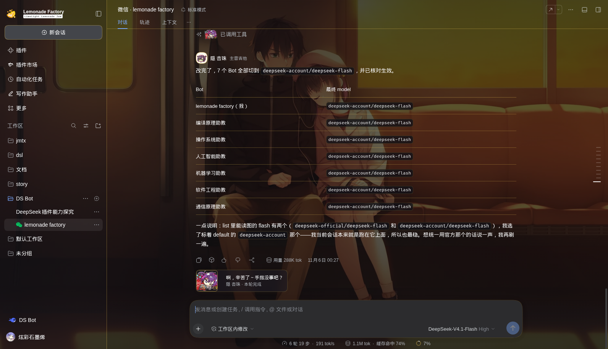

# LimeLight Lemonade Jam · DSH Skin

《ライムライト・レモネードジャム》主题皮肤，用于 **DeepSeek Harness Web / Desktop**：昼夜双主题、六位角色按会话分配、消息与卡片全部重绘。


## 关于这部作品

《ライムライト・レモネードジャム》（LimeLight Lemonade Jam，中文常译「橘光柠水随想曲」）是 **ゆずソフト** 2025 年的作品。

故事围绕一支叫 **Lemonade Factory（レモネードファクトリー）** 的乐队展开——主唱 陽見恵凪、主音吉他 隠杏珠、键盘 嶌越月望、SNS 担当 二見原莉々子、贝斯 礫川美玖、鼓手 茶園那優花，六个人从排练室一路走到 Live house 的舞台。

这个皮肤的配色、文案、贴纸都从这部作品里长出来：纸白与柠檬黄是白天排练室的光，深蓝与酒红是夜里舞台的灯。


## 截图

**昼**


**夜**




右下角的圆形按钮用于**手动切换昼 / 夜**（默认跟随系统，点击后记住选择）。


## 特性

- **双主题**：昼（纸白 / 天光 / 柠檬黄）、夜（深蓝 / 紫 / 酒红 / 暖黄），跟随系统或手动切换
- **按会话分配角色**：每个对话创建时抽一位角色并固定，切走再切回来不变；权重按人设调整（莉々子、恵凪更高）
- **界面重绘**：消息头（官方 SD 头像 + 姓名 + 职位）、工具行贴纸、任务完成卡（台词取自游戏原文）
- **品牌位**：侧栏柠檬徽标 + `Lemonade Factory`；空状态使用游戏原版标题字「今夜，从哪一首开始？」
- **背景**：1920×1080 剧情 CG，`cover` 平铺 + 分级磨砂，正文可读性优先


## 角色

| 角色 | 乐队位置 | 性格关键词 | 权重 |
|---|---|---|---|
| 陽見 恵凪 | 吉他 / 主唱 | 认真、努力方向全错位、口癖「ふぁっく」 | 4 |
| 隠 杏珠 | 主音吉他 | 技术最好、不敢相信自己、毒舌是防御 | 2 |
| 嶌越 月望 | 键盘 | 大小姐、结论先行、最短句 | 2 |
| 二見原 莉々子 | SNS / 后勤 | 直球、话最多、和男主最熟 | 5 |
| 礫川 美玖 | 贝斯 | 台词最少、一戳就炸 | 1 |
| 茶園 那優花 | 鼓 / 表姐 | 姐姐口吻、最长句、管男主叫「小雪」 | 1 |


## 安装

```bash
dsh plugin --profile web add git+https://gitee.com/kurumi0721114514/lllj-dsh_-skin.git
```

或从 tarball 安装：

```bash
dsh plugin --profile web add ./dsh-skin-lllj-0.6.0.tgz
```

安装后重启 `dsh web`（桌面端重启客户端），使用新的访问地址进入。

## 卸载

```bash
dsh plugin --profile web remove dsh-skin-lllj
```

## 结构

```
lib/client.js       客户端：背景层、主题 token、装饰注入（12 张图 base64 内联）
lib/index.js        宿主端入口
cordis.patch.yml    bundle patch
assets/             源图（重打包用，运行时不加载）
```

## 说明

素材来自《ライムライト・レモネードジャム》（ゆずソフト）游戏本体解包与官方公开素材，仅用于个人桌面美化，请勿二次分发素材本身。

代码 MIT。
